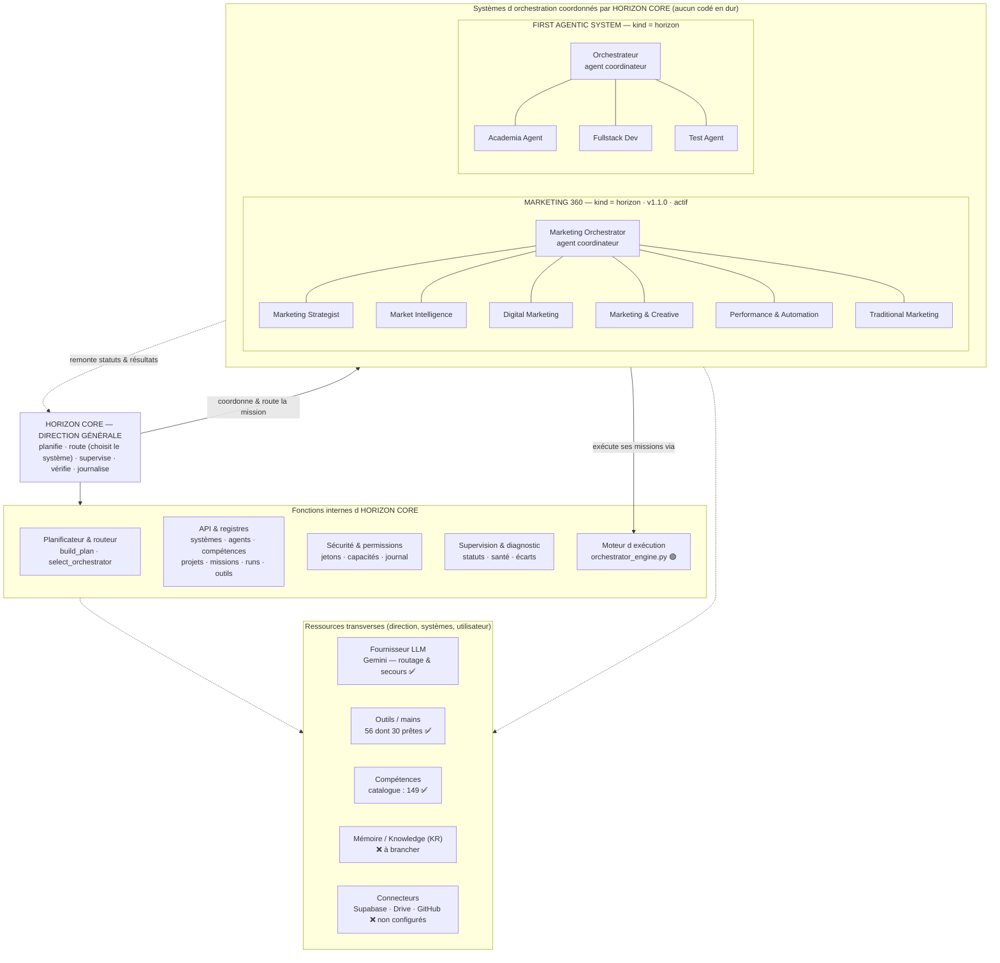

# ORGANIGRAMME — HORIZON CENTRAL AI

Cet organigramme décrit la **hiérarchie de coordination réelle** (qui pilote quoi),
et non une chaîne d'exécution. Vérifié en ligne le 2026-11-27.

**HORIZON CORE est la direction générale.** Il planifie, **route** la demande vers le
système d'orchestration compétent, supervise, vérifie et journalise. Il **coordonne les
orchestrateurs** : il ne les remplace jamais et ne se substitue pas à leur agent
coordinateur (source : `core.py` « HORIZON CORE — planification et routage » ;
`agents.py` « HORIZON CORE supervise les systèmes ; chaque système garde son agent
coordinateur »).

Légende : ✅ existe (code / en ligne) · 🟢 opérationnel (testé en production) ·
🟡 partiel · ❌ à brancher.

## Organigramme (hiérarchie de coordination)



## Rendu lisible (texte)

```
HORIZON CORE — DIRECTION GÉNÉRALE
planifie · route (choisit le système) · supervise · vérifie · journalise
│
├── Fonctions internes
│     ├── Planificateur & routeur .... build_plan · select_orchestrator
│     ├── API & registres ........... systèmes · agents · compétences · projets ·
│     │                                missions/étapes · runs · outils
│     ├── Sécurité & permissions .... jetons · capacités · journal
│     ├── Supervision & diagnostic .. statuts · santé · écarts
│     └── Moteur d exécution ........ orchestrator_engine.py  🟢
│
├── Coordonne les systèmes d orchestration (aucun codé en dur)
│     ├── MARKETING 360 (kind = horizon · v1.1.0 · actif)
│     │     Marketing Orchestrator (coordinateur)
│     │        ├── Marketing Strategist      ├── Marketing & Creative
│     │        ├── Market Intelligence       ├── Performance & Automation
│     │        └── Digital Marketing         └── Traditional Marketing
│     └── FIRST AGENTIC SYSTEM (kind = horizon)
│           Orchestrateur (coordinateur)
│              ├── Academia Agent   ├── Fullstack Dev   └── Test Agent
│
└── Ressources transverses
      ├── Fournisseur LLM (Gemini) ......................... ✅
      ├── Outils / mains — 56 dont 30 prêtes ............... ✅
      ├── Compétences — catalogue 149 ...................... ✅
      ├── Mémoire / Knowledge (KR) ......................... ❌ à brancher
      └── Connecteurs Supabase · Drive · GitHub ............ ❌ non configurés
```

## Lecture rapide

| Niveau | Rôle | État |
|---|---|---|
| **HORIZON CORE (direction générale)** | planifie, **route la demande vers le système compétent**, supervise, vérifie, journalise ; **coordonne les orchestrateurs** | ✅ |
| **Fonctions internes** | planificateur/routeur, API & registres, sécurité & permissions, supervision & diagnostic | ✅ |
| **Moteur d exécution** | capacité commune : décompose → route vers les agents → exécute → suit → consolide | 🟢 **opérationnel** (`orchestrator_engine.py` ; mission `1acfa905` : 5 étapes / 5 agents) |
| **Systèmes d orchestration** | MARKETING 360 (7 agents) · FIRST AGENTIC SYSTEM (4 agents) — chacun garde son coordinateur | ✅ |
| **Ressources transverses** | LLM, mains (56 dont 30 prêtes), compétences (149), mémoire/KR, connecteurs | ✅ / ❌ selon la ligne |

## Relations (sens des liens)

- **Direction → systèmes** : coordination, choix du système, plan de mission, supervision, journalisation.
- **Systèmes → direction** : remontée des statuts et résultats (missions, étapes, exécutions).
- **Système → agents** : chaque agent coordinateur mobilise ses spécialistes.
- **Système → moteur d exécution** : le moteur est la **capacité commune** qui répartit une mission entre les agents du système.
- **Ressources** : mobilisées par la direction, par les systèmes et par l utilisateur.

## Ce qui reste à faire
1. **Boucle d appel d outils** dans le moteur : qu un agent appelle réellement une main
   (recherche web, PDF, image, fichiers) au cours de son étape.
2. **Revue qualité** formalisée après la consolidation (elle distingue déjà faits,
   estimations et hypothèses).
3. **Parallélisation** des étapes indépendantes et reprise ciblée d une étape en échec.
4. Test PDF **en ligne** après dépôt d un document réel dans l espace de travail serveur.
