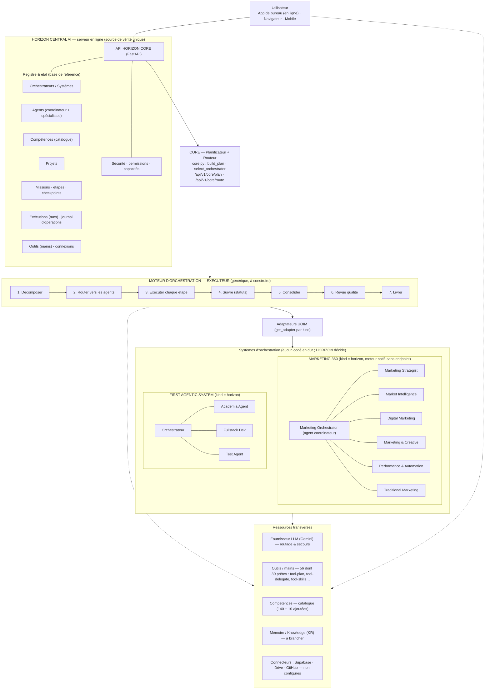

# ORGANIGRAMME — HORIZON CENTRAL AI (avec l'exécuteur)

Ce document décrit **l'organisation réelle** du système, y compris le **moteur
d'orchestration (exécuteur)** en cours de construction. Légende des états :

- ✅ **existe** (vérifié dans le code / en ligne)
- 🟡 **à construire** (le moteur multi-agents)
- ❌ **à brancher** (mémoire/KR, politiques d'action, connecteurs)

## Lecture rapide

| Étage | Rôle | État |
|---|---|---|
| **Utilisateur** | app de bureau (mode en ligne), navigateur, mobile | ✅ |
| **API CORE** | registres (systèmes, agents, compétences, projets, missions, runs, outils) + sécurité + journal | ✅ |
| **CORE planificateur / routeur** | transforme une demande en mission + étapes et choisit le système | ✅ |
| **MOTEUR (exécuteur)** | décompose → route vers les **agents** → exécute → suit → consolide → revue → livre | 🟡 **à construire** |
| **Adaptateurs (UOIM)** | branche tout type de système sans code en dur | ✅ |
| **Systèmes** | MARKETING 360 (7 agents) · FIRST AGENTIC SYSTEM (4 agents) | ✅ |
| **Ressources** | LLM, outils, compétences, mémoire/KR, connecteurs | ✅ / ❌ selon la ligne |

## Ce que l'exécuteur utilisera (déjà en place)
Missions, **étapes**, checkpoints, **runs** (statut/sortie/usage/runtime), journal ;
`effective_skills` (compétences par agent) ; outil **`tool-delegate`** (déléguer à un
`agent_id`) ; outil **`tool-plan`** ; adaptateurs par `kind` ; fournisseur LLM.

## Ce qui manque pour qu'il fonctionne
1. **`agent_id`** sur les étapes et les exécutions (aujourd'hui : `assigned_orchestrator_id` seulement) ;
2. **l'exécuteur d'étapes** (la boucle) et la **consolidation/revue** ;
3. la **boucle d'appel d'outils** dans le moteur (pour qu'un agent appelle `tool-plan` / `tool-delegate`).
